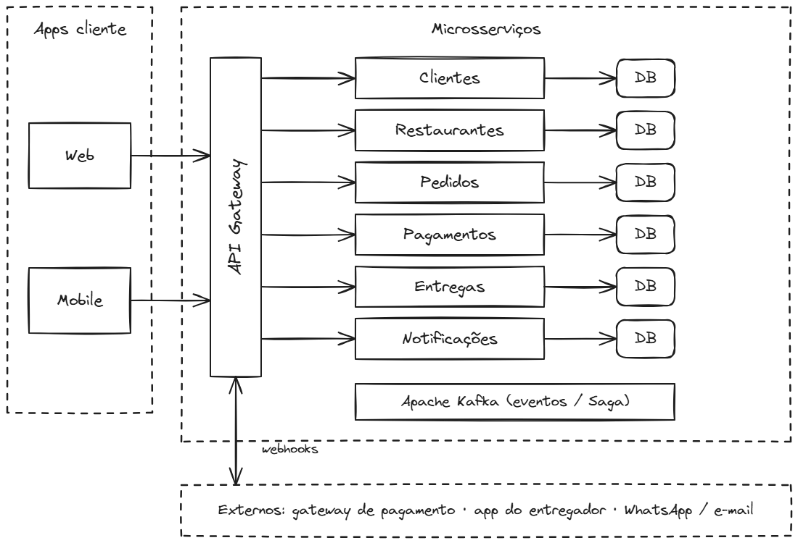
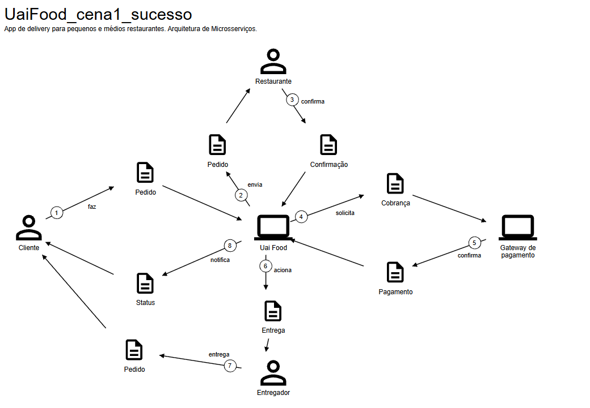
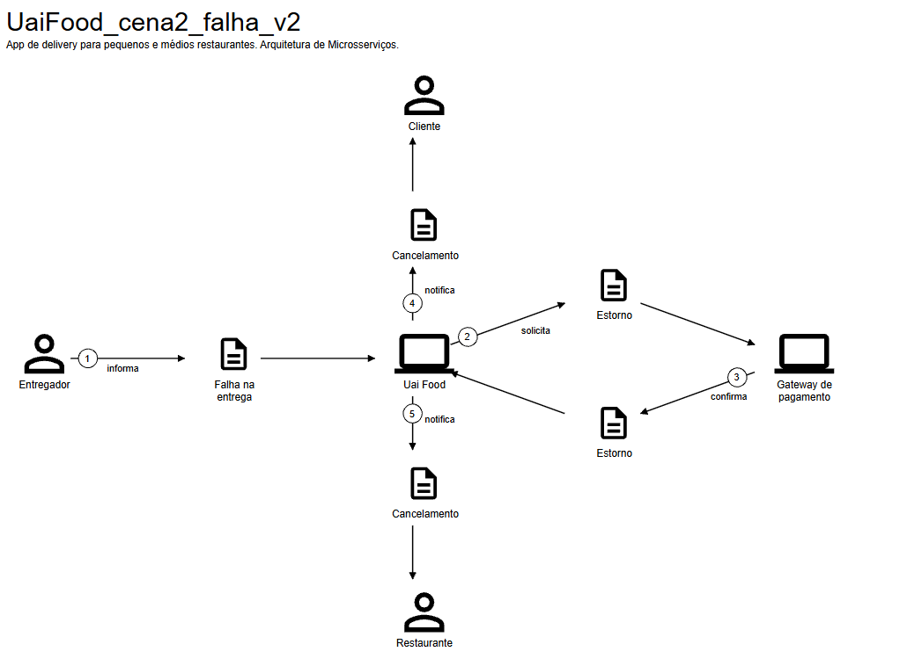
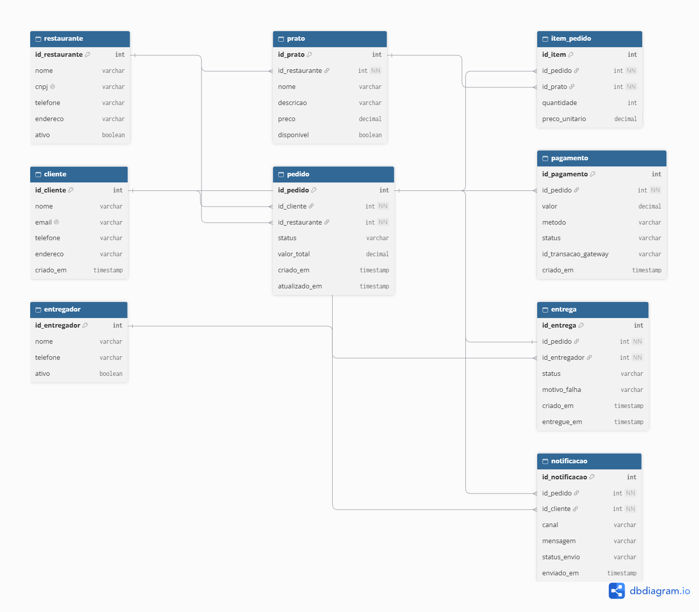
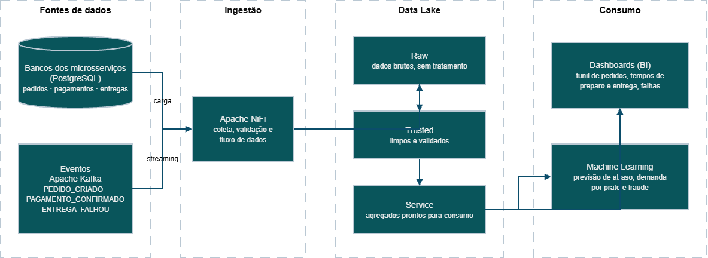

# UF - Uai Food: plataforma de delivery em microsserviços

Trabalho final da disciplina **Microservices, APIs & Webhooks** (MBA em Engenharia de Dados, FIAP). O entregável é de arquitetura: relato do problema, proposta de solução e topologia. Não há código nem deploy.

## Problema
Pequenos e médios restaurantes vendem por delivery em grandes apps, com taxas altas sobre cada pedido, ou por telefone e WhatsApp, com controle manual e canais separados. O pedido é confirmado à mão, o cliente não acompanha o status e os entregadores são acionados por mensagem. Falhas de pagamento, estoque ou entrega exigem cancelamento e estorno manuais. Nos horários de pico, pedidos se perdem e uma falha em uma etapa paralisa o atendimento.

## Proposta
**UF - Uai Food** é uma plataforma nacional de delivery para pequenos e médios restaurantes, com taxas menores que as dos grandes apps. Os usuários são clientes, restaurantes e entregadores. O objetivo é reduzir erros e perdas nos pedidos.

## Arquitetura
Seis microsserviços, cada um com seu próprio banco PostgreSQL, atrás de um API Gateway (Web e Mobile). A comunicação entre serviços é por eventos no Apache Kafka. O serviço Pedidos orquestra uma Saga: se o pagamento ou a entrega falham, ocorrem cancelamento e estorno.

| Serviço | Responsabilidade |
|---|---|
| Clientes | cadastro e perfil |
| Restaurantes | cardápio e disponibilidade |
| Pedidos | cria o pedido e orquestra o fluxo |
| Pagamentos | cobrança e estorno (webhook do gateway) |
| Entregas | despacho e status (webhook do app do entregador) |
| Notificações | avisos de status ao cliente |

## Domain Storytelling (egon.io)
Cenário de sucesso e cenário de falha, com estorno.

## Bases de dados (dbdiagram.io)
Dentro de um serviço, as tabelas se ligam por chave estrangeira. Entre serviços, a ligação é lógica, por ID, sem chave estrangeira entre bancos.

## Pipeline de dados (draw.io)
Bancos dos serviços e eventos do Kafka, ingeridos pelo Apache NiFi, vão para um data lake em três camadas (raw, trusted, service) e alimentam dashboards de BI e modelos de Machine Learning (previsão de atraso, demanda por prato e fraude).

## Conteúdo
- `docs/`: apresentação final (PPTX).
- `diagramas/img/`: imagens exportadas.
- `diagramas/fontes/`: arquivos editáveis (`.excalidraw`, `.dbml`, `.drawio`).

Ferramentas: [egon.io](https://egon.io/), [Excalidraw](https://excalidraw.com/), [dbdiagram.io](https://dbdiagram.io/), [draw.io](https://draw.io/).
